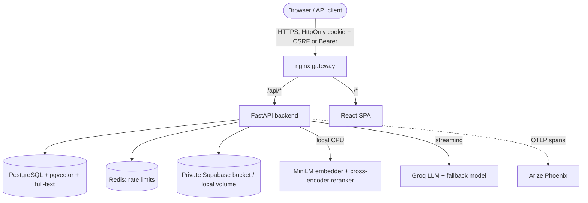

# Platform Architecture & Core Pipelines

## 1. Ingestion (`services/document_service.py`, `ingestion/`)
1. **Validation** (`ingestion/validation.py`): size cap (413), extension allow-list, MIME sanity check, magic bytes, DOCX zip-bomb/macro checks, filename sanitised (display only), SHA-256 dedupe per user (409).
2. **Storage** (`ingestion/storage.py`): random UUID object name in a private bucket or local volume. The app never fetches arbitrary URLs.
3. **Background indexing** (threadpool, so the event loop stays responsive):
   - parse (`ingestion/parser.py`): PDF pages without running headers, DOCX headings and tables, TXT/MD, CSV records
   - recursive section-aware chunking (`ingestion/chunker.py`, 1000/150)
   - embedding (normalised, batched)
   - insert chunks with owner id, section and prompt-injection heuristic score
   - mark the document `indexed`, or `failed` with an `error_message`

## 2. Question answering (`rag/pipeline.py`, used by the API and the evaluation suite)
1. Validate the question. Ownership of the session and document ids is checked **before** streaming starts.
2. Reformulate follow-ups into a standalone query (utility LLM, last 6 messages).
3. Retrieval (`retrieval/retriever.py`): exact vector search over the caller's indexed chunks, plus Postgres full-text search, fused with RRF. A cross-encoder reranks the top 10. Chunks are dropped below an absolute floor or a margin from the best chunk.
4. **No relevant chunks → fixed refusal, no LLM call.**
5. Context (`rag/context.py`): dedupe, token budget, numbered `<source>` blocks, delimiter escaping, injection warnings.
6. Generation (`llm/groq_client.py`): rules-only system prompt, sources in a separate message as untrusted data. Retries, timeout, fallback model.
7. Citation validation: invalid `[n]` stripped. `meta` event carries timings, token usage and grounding flags. The answer and sources are persisted.

## 3. Security model
See [SECURITY_AUDIT.md](../SECURITY_AUDIT.md). In short:
- Every data query is filtered by owner; optional Postgres RLS enforces the same rule in the database.
- Server-side sessions (revocable), HttpOnly cookies + CSRF, Argon2id, TOTP MFA.
- Rate limits per IP, account and user.

## 4. Observability
- Structured logs with secret redaction.
- OpenTelemetry spans with OpenInference attributes, sent to Phoenix: `rag.query` → `rag.reformulate` → `rag.retrieve` → `rag.generate`, plus `ingest.document` / `ingest.embed`. Content attributes are exported only with `TRACE_INCLUDE_CONTENT=true`.
